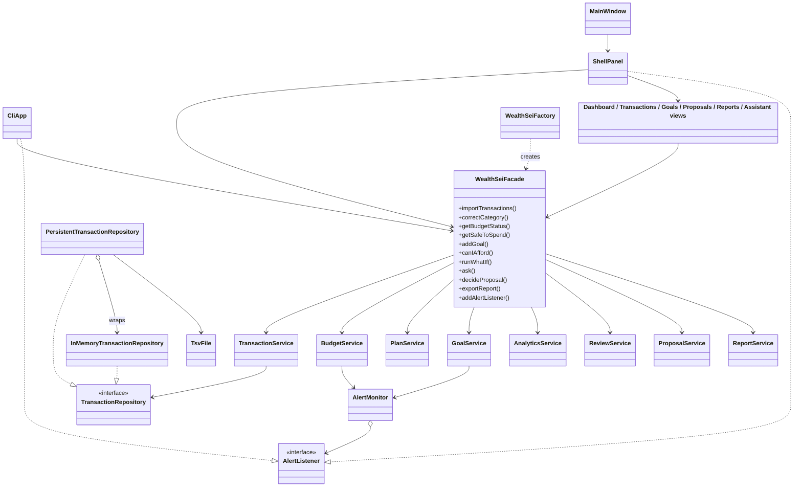
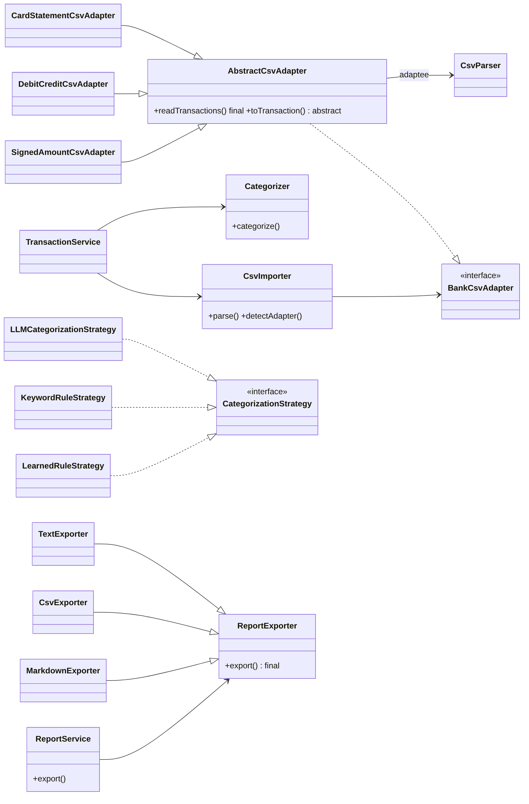
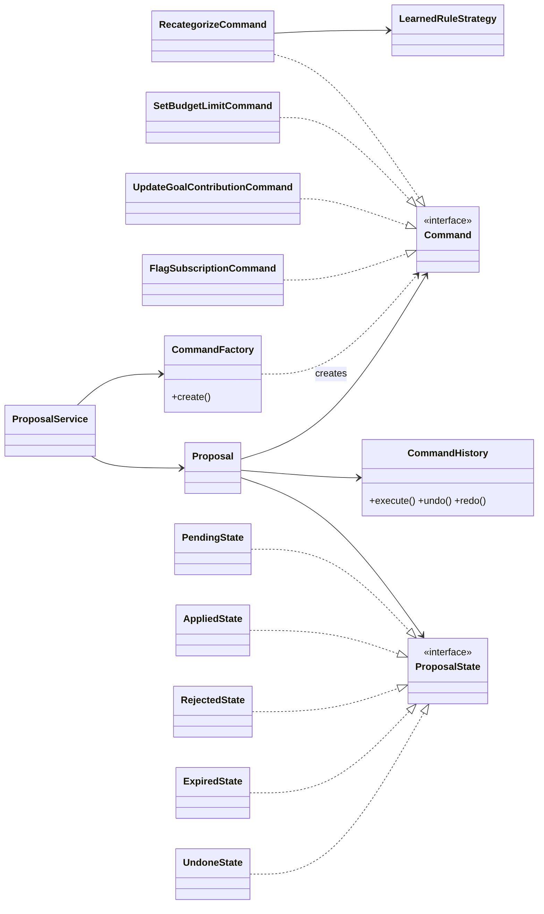
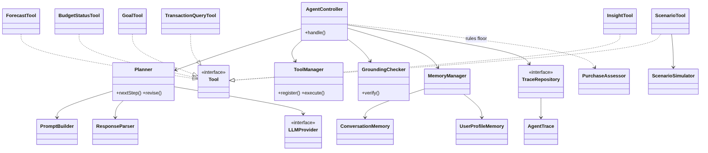
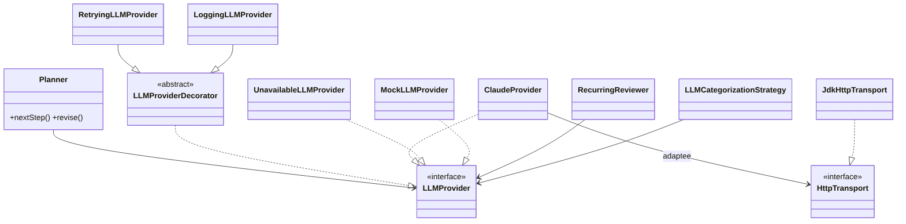
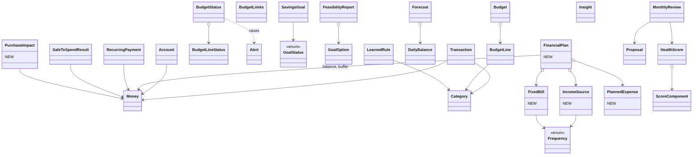
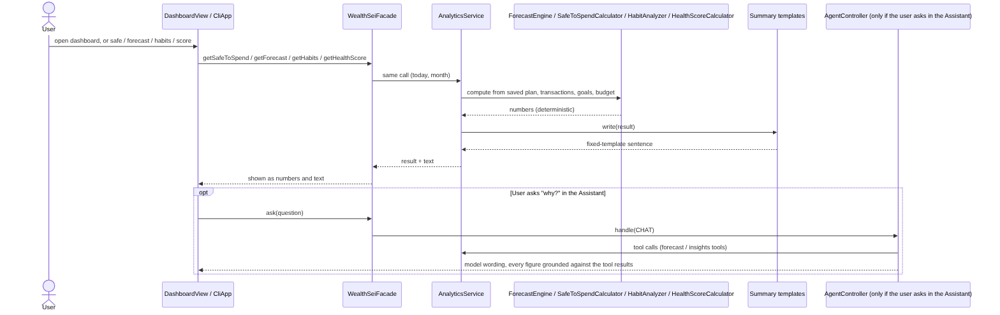
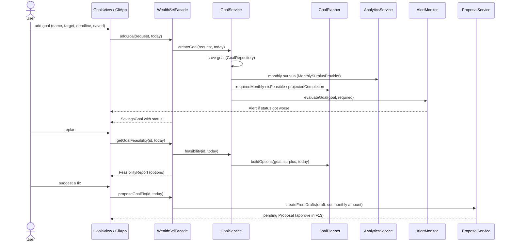
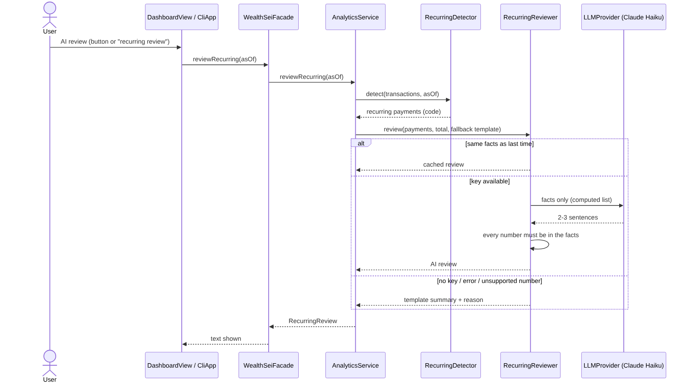

# WealthSei — Stage 2 Implementation Report
### An AI Personal Finance Agent

**Course:** EECS3311 Software Design, Fall 2026 · **Stage:** 2 (Implementation)
**Student:** Rishit Shah, _[219773050]_ · **Repository:** [github.com/Rishit-Shah/EECS-3311-Project---WealthSei](https://github.com/Rishit-Shah/EECS-3311-Project---WealthSei)

## Contents

1. Project overview and implementation status
2. Feature to implementation mapping
3. Implemented design patterns (with updated UML class diagram, use-case and sequence diagram notes)
4. Changes and rationale
5. AI tools and collaboration log
6. Development and verification summary
7. Demonstration index

---

## 1. Project overview and implementation status

### 1.1 The application

WealthSei is a personal-finance assistant for people who manage a budget without financial expertise (students, early-career workers, freelancers). It imports bank and credit-card CSV statements, categorizes the spending, tracks budgets and savings goals, projects the balance for the next 30 days, and answers decision questions such as "Can I afford this laptop?" or "What changes if I cancel two subscriptions?". It runs as a Swing desktop application (GUI) and as an interactive command-line program (CLI); both call the same `WealthSeiFacade`, so the two interfaces behave identically. Data is stored in plain text files in a local folder (`~/.wealthsei`), nothing leaves the machine except the AI calls described below.

Technology: Java 17, Maven, JUnit 5 (the only dependency). The Claude API is called with the JDK's HTTP client; there is no third-party library in the application itself.

### 1.2 How the AI/LLM is integrated

All numbers (budget status, forecast, safe-to-spend, goal feasibility, health score, what-if results) are computed by ordinary code. The model is used for language and for deciding which tools to call, and every answer is checked against the numbers the tools returned.

| Part | Model | What it does |
|---|---|---|
| F02 categorizer (`LLMCategorizationStrategy`) | `claude-haiku-5-5` | Last-resort category for a merchant that no learned rule or keyword recognizes; must answer with one allowed category. |
| F04 recurring review (`RecurringReviewer`) | `claude-haiku-5-5` | Writes 2–3 sentences about the detected recurring payments from the computed list only. |
| Tool-using agent (`AgentController`, `Planner`, `PromptBuilder`) | `claude-sonnet-5-5` | F08 affordability, F10 scenario parsing and explanation, F11 monthly review text, F12 chat; also explains F05–F07 and F09 results when asked in the chat (the model calls the tools, the tools return the numbers). |

Safeguards: `GroundingChecker` compares every dollar amount, percentage, decimal and number of 100 or more in the model's answer with the tool results (one correction attempt, then the answer is flagged); `PurchaseAssessor` rules act as a floor for affordability (the model may be more cautious, never more optimistic); `PlainText` strips markdown from answers; the full trace of tool calls is kept and can be shown (`trace`, Assistant → trace button); `LoggingLLMProvider` writes model, token count and time of each call to `llm.log` (never the key, the questions or the data). Without an API key the app starts normally: categorization falls back to rules, reviews and explanations use fixed templates, and the agent commands say the AI is unavailable (affordability is still answered from the rules).

### 1.3 Current working functionality

All 14 Stage 1 features (F01–F14) are implemented and work in both the GUI and the CLI, plus three additions (financial plan setup, saved data, AI call log). 596 unit tests pass (`mvn test`). Each feature has a recorded demonstration (Section 7).

| ID | Feature | Type in Stage 1 | Type as implemented | Status |
|---|---|---|---|---|
| F01 | Import transactions (CSV or manual entry) | Deterministic | Deterministic | Implemented (modified: own CSV reader, extra card-statement layout; manual entry `NewTransaction` added at the end of Stage 2, see C17) |
| F02 | Smart categorization and correction (with undo) | Hybrid | Hybrid | Implemented |
| F03 | Budget setup, tracking and alerts | Deterministic | Deterministic | Implemented |
| F04 | Recurring payment and subscription detector | Hybrid | Hybrid | Implemented (AI review added as a button/command) |
| F05 | Safe-to-spend coach | Hybrid | Deterministic + AI explanation on request | Implemented (modified) |
| F06 | Spending habit detective | Hybrid | Deterministic + AI explanation on request | Implemented (modified) |
| F07 | Financial health score | Hybrid | Deterministic + AI explanation on request | Implemented (modified; change from last month not computed) |
| F08 | Purchase affordability check | AI (agent) | AI (agent) | Implemented |
| F09 | Savings goal planner with replan | AI (agent) | Deterministic planner; the agent reads goals through a tool | Implemented (modified) |
| F10 | What-if scenario simulator | AI (agent) | Hybrid (AI parses plain words; typed form needs no AI) | Implemented |
| F11 | Monthly review and fix plan | AI (agent) | AI (agent) with numbers-only fallback | Implemented |
| F12 | Natural-language chat with agent trace | AI (agent) | AI (agent) | Implemented |
| F13 | Proposal approval queue | Hybrid | Deterministic queue; drafts come from the agent, what-if, goals | Implemented |
| F14 | Report export | Deterministic | Deterministic | Implemented |
| N01 | Financial plan setup (balance, buffer, income, bills, planned expenses) | New | Deterministic | Implemented |
| N02 | Saved data between sessions (text files) | New (Stage 1 planned SQLite) | Deterministic | Implemented |
| N03 | AI call log and `aicalls` command | New | Deterministic | Implemented |

### 1.4 Limitations and incomplete functionality (stated honestly)

- **Not saved between runs:** pending proposals, generated monthly reviews, agent traces, the undo/redo history and the chat memory window are kept for the session only. (Learned rules, protected categories, goals, budgets, the plan, transactions and recurring flags are saved.) After a restart a budget alert already shown can appear once more.
- **Explanations of F05–F07 are templates on the dashboard.** The AI explains them only when asked through the Assistant/`ask`; Stage 1 described an automatic AI explanation on each screen. The numbers are the same either way.
- **F09 planning is plain code.** Stage 1 had the agent plan and replan goals; in the implementation `GoalPlanner` does it and the agent can read and discuss goals. No automatic re-planning button beyond the goal screen's feasibility view and "suggest a fix".
- **CSV support is three layouts:** signed-amount, debit/credit columns, and the credit-card statement layout. A card export that shows purchases as positive numbers in the first two layouts would be read as income. An amount such as `12,50` is rejected rather than guessed. Currency is a single (dollar) currency.
- **F07 "change from last month" is not computed:** the score is not stored per month, so the Stage 1 comparison with the previous month is missing (the field exists and is always empty).
- **Month errors:** some commands show a raw parse message for an invalid month (`habits 2026-13`); the health score for a month with no data is shown without a clear "no data" notice. Duplicate goal names are allowed.
- **Needs a network and a key for AI features;** answers can vary between runs, which is why every figure is grounded against tool results.
- **Not done in Stage 2 (by design):** full deterministic test coverage of every rule and KUMA agent validation belong to Stage 3. The GUI is verified by logic tests (`GuiLogicTest`) and by the recorded demonstrations, not by automated screen tests.
- **Stage 1 design differences** (Swing instead of JavaFX, own HTTP/JSON/CSV code instead of LangChain4j and Apache Commons CSV, text files instead of SQLite, a hand-written CLI parser instead of picocli) are explained in Section 4.

---

## 2. Feature to implementation mapping

Package folders are under `src/main/java/wealthsei/`. "GUI" screens are in `presentation/gui`, the CLI is `presentation/cli/CliApp.java`, and every request goes through `facade/WealthSeiFacade.java` (Facade pattern), whose objects are wired by `facade/WealthSeiFactory.java`. Video links are filled in Section 7 (GUI and CLI recordings of every feature).

### F01 — Import Transactions (CSV) · Deterministic

| Field | Details |
|---|---|
| **Feature ID and name** | F01 — Import Transactions (CSV) |
| **Stage 1 feature/reference** | F01 (UC01, SD01) |
| **Status or change** | **Modified.** Same behaviour; the CSV is read by our own `CsvParser` instead of Apache Commons CSV; a third layout (credit-card statements) was added; card payments are skipped rather than imported as income. |
| **Implemented classes/files and responsibilities** | `importing/CsvImporter` reads the header and chooses the adapter. `importing/BankCsvAdapter` (interface) with `AbstractCsvAdapter` (reads rows, template), `SignedAmountCsvAdapter`, `DebitCreditCsvAdapter`, `CardStatementCsvAdapter` (+ `CardMerchantCleaner`: tidies merchant names, skips card payments) turn rows into `Transaction` objects. `CsvParser`/`CsvRecord`/`RowParsing` split lines, handle quotes and parse dates and amounts. `service/TransactionService` removes duplicates, calls the `Categorizer` (F02) and saves through `TransactionRepository`. `domain/ImportResult`, `ParseResult` report counts and rejected rows. GUI: `TransactionsView`/`ShellPanel` (Import button, file chooser, summary). |
| **Key methods** | `CsvImporter.parse(Path)`, `detectAdapter(header, parser)`, `AbstractCsvAdapter.readTransactions()`, `toTransaction(CsvRecord)`, `TransactionService.importFile(Path)`, `WealthSeiFacade.importTransactions(file, today)`, `CliApp.importFile` |
| **Design patterns** | Adapter (CSV layouts behind one interface), Template Method (`AbstractCsvAdapter.readTransactions()` is final, subclasses supply `toTransaction`), Facade, Decorator (`PersistentTransactionRepository`) |
| **Video link/timestamp** | [GUI video](https://www.youtube.com/watch?v=IuKLwaqHMj4) · [CLI video](https://www.youtube.com/watch?v=S9wAQwrDvTk) (both show CSV import, duplicate skipping, and manual entry) |

**How the classes collaborate.** The user picks a file in the GUI (or types `import <file>`); the call reaches `WealthSeiFacade.importTransactions`, which gives the path to `TransactionService.importFile`. `CsvImporter` reads the header row and asks each adapter whether it matches (`detectAdapter`); the matching adapter's final `readTransactions()` loops over the rows and calls its own `toTransaction` for each, collecting bad rows as rejected with a reason. `TransactionService` drops transactions already stored (same date, amount, merchant; matched by count so two real identical purchases in one file are both kept), categorizes the new ones through `Categorizer` (F02), and saves them. Back in the facade, `BudgetService.refreshAlerts` re-checks only the months touched (F03) and `GoalService.evaluateAll` re-checks goals (F09). The Stage 1 diagrams also allow a second input, a hand-typed `NewTransaction` (date, amount, merchant, description, optional category, income flag): the GUI "Add transaction" button or the CLI `add` command calls `WealthSeiFacade.addTransaction`, which calls `TransactionService.addTransaction`; its private `validate` rejects a missing date, a zero amount or a blank merchant, the category is the chosen one or the `Categorizer`'s answer, and the facade then refreshes that month's alerts and the goals the same way as for an import. The user sees "Imported n, skipped d duplicates, rejected r rows". This feature is deterministic: no model call.

### F02 — Smart Categorization and Correction (with Undo) · Hybrid

| Field | Details |
|---|---|
| **Feature ID and name** | F02 — Smart Categorization and Correction (with Undo) |
| **Stage 1 feature/reference** | F02 (UC02, SD02) |
| **Status or change** | **Implemented.** Command renamed as in Stage 1 (`RecategorizeCommand`); extra `CategoryCorrector` groups the undo/redo calls. The AI step runs only when an API key exists. |
| **Implemented classes/files and responsibilities** | `service/Categorizer` tries each `CategorizationStrategy` in order until one answers. `LearnedRuleStrategy` (merchant rules the user taught, stored by `RuleRepository`), `KeywordRuleStrategy` (built-in keywords), `LLMCategorizationStrategy` (Haiku, last resort, answer must be one allowed category). `command/RecategorizeCommand` changes the category and teaches (or forgets) the rule; `CommandHistory` runs it and keeps undo/redo; `CategoryCorrector` is the facade-side helper. GUI: category drop-down and Undo/Redo in `TransactionsView`. |
| **Key methods** | `Categorizer.categorize(Transaction)`, `CategorizationStrategy.categorize`, `LearnedRuleStrategy.learn/forget/ruleFor`, `LLMCategorizationStrategy.categorize`, `RecategorizeCommand.execute/undo`, `CommandHistory.execute/undo/redo`, `WealthSeiFacade.correctCategory/undoCorrection/redoCorrection`, `CliApp` `correct`, `undo`, `redo` |
| **Design patterns** | Strategy (chain of categorizers), Command (undoable correction), Facade |
| **Video link/timestamp** | [GUI video](https://www.youtube.com/watch?v=wP0EjDVBP4Q) · [CLI video](https://www.youtube.com/watch?v=Nerwf8442Z4) |

**How the classes collaborate.** *Automatic:* during import `Categorizer` asks `LearnedRuleStrategy` first, then `KeywordRuleStrategy`, and only if both return nothing and a key is configured, `LLMCategorizationStrategy` (a small Haiku request listing the allowed categories; an answer outside the list is rejected and the transaction stays `Uncategorized`). *Manual:* a correction in the GUI or `correct <txId> <category>` reaches the facade, which builds a `RecategorizeCommand` (through `CategoryCorrector`) and hands it to `CommandHistory.execute`. The command updates the transaction through `TransactionService.updateCategory` and calls `LearnedRuleStrategy.learn` so the next import of that merchant is correct; `undo` restores the old category and the old rule (or removes the new one). Income and "Uncategorized" corrections are not learned. Budget alerts for the affected month are then refreshed. Hybrid: rules and undo are deterministic; the model is only the last-resort strategy.

### F03 — Budget Setup, Tracking and Alerts · Deterministic

| Field | Details |
|---|---|
| **Feature ID and name** | F03 — Budget Setup, Tracking and Alerts |
| **Stage 1 feature/reference** | F03 (UC03, SD03) |
| **Status or change** | **Implemented.** Added `BudgetCalculator` (pure calculation) and `PlanService` (balance and plan, see N01); alerts are not repeated at start-up (`primeAlerts`). |
| **Implemented classes/files and responsibilities** | `service/BudgetService` saves limits and returns the status; `BudgetCalculator.compute` counts the month's expenses against each limit (80% or more = warning, over 100% = over); `AlertMonitor` raises an `Alert` only when a category's level gets worse and tells its listeners; `BudgetRepository` (`InMemory…`, `PersistentBudgetRepository`); domain `Budget`, `BudgetLine`, `BudgetLimits`, `BudgetStatus`, `BudgetLineStatus`, `Alert`. GUI: dashboard budget card, `PlanDialogs`, toast alerts from `ShellPanel`. |
| **Key methods** | `BudgetService.setBudget/setLimit/getStatus/refreshAlerts/primeAlerts`, `BudgetCalculator.compute`, `AlertMonitor.attach/evaluate/publish`, `WealthSeiFacade.setBudget/getBudgetStatus/addAlertListener`, `SetBudgetLimitCommand` (used by F13) |
| **Design patterns** | Observer (`AlertMonitor` subject, `AlertListener` observers), Decorator (persistent repository), Facade |
| **Video link/timestamp** | [GUI video](https://youtu.be/T7yu2Cuq-7c) · [CLI video](https://www.youtube.com/watch?v=TSALZRgdeQQ) |

**How the classes collaborate.** `budget set 2026-10 dining=450 …` (or the GUI form) calls `BudgetService.setBudget`, which stores the limits and immediately recomputes the status: `BudgetCalculator.compute` sums that month's expense transactions per category and divides by the limit. `AlertMonitor.evaluate` compares the new level with the last level it published for that category and, only if it got worse (none → warning → over), builds an `Alert` and calls every attached `AlertListener`: the CLI prints it, the GUI `ShellPanel` shows a toast. Importing or correcting transactions calls `refreshAlerts` for the affected months. Deterministic.

### F04 — Recurring Payment and Subscription Detector · Hybrid

| Field | Details |
|---|---|
| **Feature ID and name** | F04 — Recurring Payment and Subscription Detector |
| **Stage 1 feature/reference** | F04 (UC04, SD04) |
| **Status or change** | **Modified.** The detection is as designed. The AI wording is a separate "AI review" button/command (`recurring review`) rather than part of every refresh, to limit cost and waiting time; a fixed template is the fallback. |
| **Implemented classes/files and responsibilities** | `analytics/RecurringDetector.detect` groups expenses by merchant and checks regular gaps and steady amounts; `RecurringPayment` (carries `priceIncrease`, `occurrences`); `AnalyticsService` (report, flags); `RecurringReport` + `RecurringSummaryTemplate` (total and template text); `RecurringReviewer` (Haiku: 2–3 sentences from the computed list; every number in the reply must appear in the facts, answers cached for identical facts) and `RecurringReview`; `RecurringRepository` (`PersistentRecurringRepository`) stores review flags. GUI: dashboard "Recurring" card with the AI-review button (runs in a background worker). |
| **Key methods** | `RecurringDetector.detect(txs, asOf)`, `AnalyticsService.recurringReport/reviewRecurring/flagRecurring`, `RecurringReviewer.review/facts/numbersComeFrom`, `WealthSeiFacade.recurringPayments/reviewRecurring/flagRecurring`, `CliApp` `recurring`, `recurring review`, `recurring flag|unflag` |
| **Design patterns** | Strategy-like fallback (reviewer vs. template), Facade, Decorator (persistent flags) |
| **Video link/timestamp** | [GUI video](https://youtu.be/CL4O3BdPj9Y) · [CLI video](https://youtu.be/oFYOGEhMv6s) |

**How the classes collaborate.** `recurring` → facade → `AnalyticsService.recurringReport(asOf)` loads transactions, runs `RecurringDetector.detect` (at least 3 payments, at least 75% regular gaps, at least 50% steady amounts; confidence = 0.6 × regular gaps + 0.4 × steady amounts; a pattern whose last payment is over two intervals old counts as cancelled), and adds the template summary. `recurring flag <merchant>` stores a flag through `RecurringRepository` (refused if the merchant is not a detected recurring payment). `recurring review` (or the GUI button) builds a facts list from the detected payments and asks `RecurringReviewer` (Haiku); if the reply contains a figure not in the facts, or the model is unavailable, the template summary is shown with the reason. Hybrid: detection and flags are deterministic; the sentence wording is AI.

### F05 — Safe-to-Spend Coach · Hybrid (implemented: deterministic, AI explanation on request)

| Field | Details |
|---|---|
| **Feature ID and name** | F05 — Safe-to-Spend Coach |
| **Stage 1 feature/reference** | F05 (UC05, SD04) |
| **Status or change** | **Modified.** Calculation and forecast as designed. The explanation on the dashboard/`safe` is a fixed template; the AI explains it only when asked in the Assistant. |
| **Implemented classes/files and responsibilities** | `analytics/ForecastEngine.project(inputs, days)` builds the daily balance from income, plan bills, recurring payments and planned expenses; `ForecastInputs` (with `deepCopy`, also used by F10); `SafeToSpendCalculator.calculate(forecast, goals, buffer)` returns `SafeToSpendResult`; `SafeToSpendSummaryTemplate` (text); `AlertMonitor.evaluateLowBalance`; domain `Forecast`, `DailyBalance`, `SafeToSpendResult`. GUI: dashboard hero card and balance chart (`HeroBalanceCard`, `LineChart`). |
| **Key methods** | `ForecastEngine.project/monthlySurplus`, `SafeToSpendCalculator.calculate`, `AnalyticsService.safeToSpend/forecast/baselineInputs`, `WealthSeiFacade.getSafeToSpend/getForecast`, `CliApp` `safe`, `forecast` |
| **Design patterns** | Prototype (`ForecastInputs.deepCopy`), Observer (low-balance alert), Facade |
| **Video link/timestamp** | [GUI video](https://youtu.be/VXB-AQRf45U) · [CLI video](https://youtu.be/XkTgEJcGAMg) |

**How the classes collaborate.** `safe` → facade → `AnalyticsService.safeToSpend(today)`: `baselineInputs` gathers the saved plan (balance, buffer, income, bills), recurring payments and planned expenses; `ForecastEngine.project` produces the day-by-day balance; `SafeToSpendCalculator.calculate` takes the balance plus income before month end, minus bills before month end, minus the monthly amount reserved for open goals, minus the safety buffer, divided by the days left in the month. `AlertMonitor.evaluateLowBalance` raises a low-balance alert once if the lowest projected balance falls under the buffer. The template writes the sentence. Asking "why is it $208?" in the Assistant lets the agent call the forecast tool and explain the same figures (checked by `GroundingChecker`). Deterministic core.

### F06 — Spending Habit Detective · Hybrid (implemented: deterministic, AI explanation on request)

| Field | Details |
|---|---|
| **Feature ID and name** | F06 — Spending Habit Detective |
| **Stage 1 feature/reference** | F06 (UC06, SD04) |
| **Status or change** | **Modified** (explanation on request only, as F05). |
| **Implemented classes/files and responsibilities** | `analytics/HabitAnalyzer.analyze(txs, month)` applies five fixed-threshold rules (weekend spike, payday splurge, month-end crunch, small-purchase leak, unusual expense = above the category mean + 2 standard deviations) to non-essential spending only; `domain/Insight` + `InsightType`; `InsightTool` lets the agent read the findings. GUI: dashboard "Needs attention" card (up to 8 rows with caps). |
| **Key methods** | `HabitAnalyzer.analyze`, `AnalyticsService.habits`, `WealthSeiFacade.getHabits`, `CliApp` `habits <month>`, `InsightTool.execute` |
| **Design patterns** | Facade; (tool use through `ToolManager`, see F08) |
| **Video link/timestamp** | [GUI video](https://youtu.be/NX8BO9QgJ7c) · [CLI video](https://youtu.be/H1Pr89MZJmw) |

**How the classes collaborate.** `habits 2026-10` → facade → `AnalyticsService.habits(month)` loads that month's (and history) transactions and passes them to `HabitAnalyzer`, which returns a list of `Insight` records (type, headline, numbers). Fewer than 30 days of history gives a "need more data" message; no findings gives "no notable patterns". The dashboard merges these findings with over-budget categories in one card. In the Assistant, a question about habits makes the agent call `InsightTool`, which returns the same insights as tool results. Deterministic core.

### F07 — Financial Health Score · Hybrid (implemented: deterministic, AI explanation on request)

| Field | Details |
|---|---|
| **Feature ID and name** | F07 — Financial Health Score |
| **Stage 1 feature/reference** | F07 (UC06, SD04) |
| **Status or change** | **Modified.** `ScoreComponent` gained a `detail` field and `HealthScore` an `excluded` list. **Not implemented:** the "change from last month" in the Stage 1 specification (`HealthScore` has the field `previousTotal` and `changeFromLastMonth()`, but there is no stored history of past scores, so it is always empty). The explanation is a template unless asked in the Assistant. |
| **Implemented classes/files and responsibilities** | `analytics/HealthScoreCalculator.calculate(status, forecast, goals)` scores budget adherence, savings rate, emergency buffer and goal progress with weights 30/25/25/20, re-scaled when a component has no data; `biggestGap` finds what would improve the score most; `domain/HealthScore`, `ScoreComponent`; `HealthScoreSummaryTemplate`. GUI: `ScoreRing` on the dashboard. |
| **Key methods** | `HealthScoreCalculator.calculate/biggestGap`, `AnalyticsService.healthScore`, `WealthSeiFacade.getHealthScore`, `CliApp` `score [month]` |
| **Design patterns** | Facade |
| **Video link/timestamp** | [GUI video](https://youtu.be/QchTzeQavGg) · [CLI video](https://youtu.be/PUYuD7kA78E) |

**How the classes collaborate.** `score 2026-10` → facade → `AnalyticsService.healthScore` gets that month's `BudgetStatus` from `BudgetService`, the 30-day forecast from `ForecastEngine`, and the goals, and calls `HealthScoreCalculator.calculate`; each component becomes a `ScoreComponent` (score, weight, detail); a component with no data is listed in `excluded` and the other weights are re-scaled. `HealthScoreSummaryTemplate` writes the text. Deterministic core; the AI can explain the components in the chat using the same numbers.

### F08 — Purchase Affordability Check · AI (agent)

| Field | Details |
|---|---|
| **Feature ID and name** | F08 — Purchase Affordability Check |
| **Stage 1 feature/reference** | F08 (UC07, SD05) |
| **Status or change** | **Implemented** (own HTTP client instead of LangChain4j; rules act as a floor, see below). |
| **Implemented classes/files and responsibilities** | `agent/AgentController.handle(AgentTask)` runs the loop; `Planner.nextStep` asks the model (via `PromptBuilder.build`, `ResponseParser.parse`) for the next step: a tool call or a final answer; `ToolManager` holds the tools (`ForecastTool`, `BudgetStatusTool`, `GoalTool`, `TransactionQueryTool`, `ScenarioTool`, `InsightTool`) and `execute(ToolCall)`; `analytics/PurchaseAssessor.assess` applies the fixed rules (Yes / Yes-but / Wait / No) from the lowest balance after the purchase, the buffer and the daily allowance; `AffordabilityFallback` writes the answer from the rules if the model cannot be reached; `GroundingChecker.verify` checks every figure; `AgentTrace`, `TraceRepository` record the steps; `llm/*` (`ClaudeProvider`, decorators). GUI: Assistant "Can I afford" tab (`AssistantView`) with `TraceDialog`. |
| **Key methods** | `AgentController.handle/latestTrace`, `Planner.nextStep/revise`, `PromptBuilder.build`, `ToolManager.execute`, `AnalyticsService.purchaseImpact`, `PurchaseAssessor.assess`, `GroundingChecker.verify`, `WealthSeiFacade.canIAfford`, `CliApp` `afford "<item>" <price> [date]`, `trace` |
| **Design patterns** | Facade, Adapter + Decorator (LLM layer); the rules-based fallback is a plain fallback, not a pattern |
| **Video link/timestamp** | [GUI video](https://youtu.be/hgBisO-yNps) · [CLI video](https://youtu.be/mHH2tObicxQ) |

**How the classes collaborate.** `afford "laptop" 600` → `WealthSeiFacade.canIAfford` → `AgentController.handle`. The controller first runs the purchase-impact tool, so the deterministic result exists before any wording; `PurchaseAssessor` turns it into a verdict. `Planner` then sends the task, the conversation and the tool results to Sonnet (`PromptBuilder` states the rules: use tools for numbers, no markdown, say assumptions). The model may call more tools (`ToolManager.execute` returns a `ToolResult`) before it gives the final answer. `GroundingChecker.verify` compares each figure in the answer with the tool results; if one is unsupported, `Planner.revise` asks once for a corrected answer, otherwise the answer is flagged. The verdict can only be more cautious than the rules. If the model is unreachable the answer is written from the rules and says so. The trace (which tools, which figures) is stored and shown by `trace`. AI (agent) with a deterministic floor.

### F09 — Savings Goal Planner with Replan · AI (agent) in Stage 1; deterministic planner + agent reads goals as implemented

| Field | Details |
|---|---|
| **Feature ID and name** | F09 — Savings Goal Planner with Auto-Replan |
| **Stage 1 feature/reference** | F09 (UC08, SD06) |
| **Status or change** | **Modified.** Planning, feasibility and the options are plain code (`GoalPlanner`); the facade methods `planGoal/replanGoal` became `addGoal` + `getGoalFeasibility` + `proposeGoalFix`. The agent reads goals through `GoalTool` (for example in affordability and the monthly review). Goals are re-evaluated after every import and correction. |
| **Implemented classes/files and responsibilities** | `service/GoalService` (create, save money, set monthly contribution, evaluate, feasibility), `GoalPlanner` (months left, required monthly amount, projected completion, options), `MonthlySurplusProvider` (asks analytics for the monthly surplus), `GoalRepository` (+ `PersistentGoalRepository`); domain `SavingsGoal`, `GoalStatus`, `GoalRequest`, `FeasibilityReport`, `GoalOption`, `GoalOptionKind`; `AlertMonitor.evaluateGoal` (goal-risk alert); `UpdateGoalContributionCommand` (F13); `GoalTool`. GUI: `GoalsView`, `GoalRow`. |
| **Key methods** | `GoalService.createGoal/evaluateAll/feasibility/updateContribution/addSaved`, `GoalPlanner.requiredMonthly/projectedCompletion/isFeasible/buildOptions`, `WealthSeiFacade.addGoal/getGoals/getGoalFeasibility/setGoalMonthlyContribution/addToGoal/proposeGoalFix`, `CliApp` `goal add|list|replan|save|monthly` |
| **Design patterns** | Observer (goal-risk alert), Command (goal fixes through F13), Facade |
| **Video link/timestamp** | [GUI video](https://youtu.be/pjaA9EA_er0) · [CLI video](https://youtu.be/zYbl2amQ1xQ) |

**How the classes collaborate.** `goal add "Laptop" 1400 2026-12-20 350` → facade → `GoalService.createGoal`, which stores the goal. `GoalPlanner` counts the months left (a part of a month counts as a whole month), the required monthly amount, and whether the plan surplus allows it. The surplus available to a goal is the plan surplus minus what the other open goals already take (`MonthlySurplusProvider`). Status: achieved (saved reaches target), on track (monthly contribution covers the requirement), at risk (it does not, but the surplus could), behind (otherwise); a behind/at-risk status that gets worse raises a goal alert. `goal replan <id>` returns a `FeasibilityReport` with options (keep, save more, extend the deadline, reduce the target); `proposals from-goal <id>` turns the suggested monthly amount into a proposal (F13). Deterministic; the agent only reads and explains the numbers.

### F10 — What-If Scenario Simulator · AI (agent) / hybrid

| Field | Details |
|---|---|
| **Feature ID and name** | F10 — What-If Scenario Simulator |
| **Stage 1 feature/reference** | F10 (UC09, SD07) |
| **Status or change** | **Implemented.** Added a typed form that skips the model (`whatif cancel=Netflix caps=dining=150 income=200 buy=600@2026-12-01`); the tool takes four plain-text fields instead of a nested array. |
| **Implemented classes/files and responsibilities** | `agent/ScenarioTool` is the tool the model fills in; `analytics/ScenarioParser.parse(ToolArgs)` turns the fields into `ScenarioChange` objects (`CancelRecurringChange`, `CapCategoryChange`, `IncomeChange`, `OneTimeExpenseChange`) and refuses unknown names, more than 5 changes, non-positive values and dates outside six months; `ScenarioSimulator.simulate(scenario, today)` copies the baseline (`ForecastInputs.deepCopy`), applies the changes and compares six months with and without them (`ScenarioResult`); `agent/ScenarioDrafts` makes proposal drafts from a scenario. GUI: Assistant "What if" tab. |
| **Key methods** | `ScenarioParser.parse`, `ScenarioSimulator.simulate`, `ScenarioTool.execute`, `WealthSeiFacade.runWhatIf/simulateWhatIf/whatIfDrafts`, `CliApp` `whatif <text>` and `whatif key=value …` |
| **Design patterns** | Prototype (`deepCopy`), Factory-style parsing (`ScenarioParser` creates the right `ScenarioChange`), Strategy (`ScenarioChange.applyTo`), Facade |
| **Video link/timestamp** | [GUI video](https://youtu.be/sr6ZeIOjvGw) · [CLI video](https://youtu.be/fa5guZbTO-I) |

**How the classes collaborate.** `whatif "cancel Spotify and cap dining at 150"` → `AgentController` → the model calls `ScenarioTool` with fields (`cancel`, `caps`, `income_increase`, `one_time_expenses`); `ScenarioParser` validates them and creates the change objects (a partial name such as "Netflix" matches `Netflix.com` when exactly one item matches; an ambiguous name is refused with a list). `ScenarioSimulator.simulate` deep-copies the baseline inputs so the real plan is not touched, applies each change (a cap is modelled as the average monthly spend of the last up to 3 full months minus the cap, counted as extra money each month), projects six months twice and returns the difference per month and in total. The model only words the result; `GroundingChecker` checks its figures. The typed form (`whatif cancel=… caps=…`) calls `simulateWhatIf` directly with no model. Hybrid: model parses plain words and explains; simulation is deterministic.

### F11 — Monthly AI Review and Fix Plan · AI (agent)

| Field | Details |
|---|---|
| **Feature ID and name** | F11 — Monthly AI Review and Fix Plan |
| **Stage 1 feature/reference** | F11 (UC10, SD08) |
| **Status or change** | **Implemented.** The (up to three) fixes are chosen by code rules so every suggestion is backed by numbers; the model writes the review text; the previous review's short summary is given to the model from memory. Reviews are kept for the session. |
| **Implemented classes/files and responsibilities** | `service/ReviewService.generate(month)` checks the month has transactions, gets the budget status and health score, runs the agent for the "what happened / went well / to fix" text, and builds fix drafts with plain rules (`candidateFixes`); `ReviewResult`; `domain/MonthlyReview`; `ReviewRepository`; `MemoryManager.rememberReview/pastReviewSummaries`; fix proposals use F13. GUI: `ReportsView` ("Generate review"). |
| **Key methods** | `ReviewService.generate/find`, `MemoryManager.rememberReview`, `WealthSeiFacade.generateMonthlyReview/getMonthlyReview`, `CliApp` `review [month]` |
| **Design patterns** | Facade; (agent loop, see F08) |
| **Video link/timestamp** | [GUI video](https://youtu.be/c_ku3EHiG-4) · [CLI video](https://youtu.be/BVwFyLeVzNg) |

**How the classes collaborate.** `review 2026-10` → facade → `ReviewService.generate`. The service refuses a month that has not started or has no transactions, reads the month's budget status and health score, and runs the agent (`TaskType.MONTHLY_REVIEW`, with short summaries of earlier reviews from memory) so the model gathers figures through the tools and writes the review; `GroundingChecker` checks them. Independently of the model, `candidateFixes` selects fix drafts with plain rules (goals behind schedule, subscriptions whose price rose), skips those already waiting as proposals, and keeps at most three. If the model is unavailable the review is a numbers-only version. The review is stored (`ReviewRepository`) and the drafts become proposals (F13). The Reports screen shows the review and can export it (F14). AI (agent) with a numbers-only fallback.

### F12 — Natural-Language Finance Chat with Agent Trace · AI (agent)

| Field | Details |
|---|---|
| **Feature ID and name** | F12 — Natural-Language Finance Chat with Agent Trace |
| **Stage 1 feature/reference** | F12 (UC11, SD09) |
| **Status or change** | **Modified.** `ConversationMemory` is our own bounded list of recent messages (not LangChain4j's); figures from earlier answers in the window are allowed in the grounding check; a failed model call is not remembered; `forget` command added. |
| **Implemented classes/files and responsibilities** | `agent/MemoryManager.buildContext/remember/forgetConversation` joins `ConversationMemory` (recent turns) and `UserProfileMemory` (preferences such as protected categories, stored by `MemoryRepository`/`PersistentMemoryRepository`); `AgentController` (`TaskType.CHAT`); `InsightTool`, `TransactionQueryTool`, `BudgetStatusTool` for answers; `PromptBuilder` (off-topic redirect, vague times assumed and stated); `GroundingChecker`; `AgentTrace`. GUI: `ChatPanel`/`ChatDock` and `AssistantView`; `TraceDialog` shows the trace. |
| **Key methods** | `WealthSeiFacade.ask/clearConversation/latestTrace`, `MemoryManager.buildContext/remember`, `ConversationMemory.append/recent`, `UserProfileMemory.setProtected`, `CliApp` `ask "<question>"`, `forget`, `trace` |
| **Design patterns** | Facade; Adapter/Decorator (LLM layer) |
| **Video link/timestamp** | [GUI video](https://youtu.be/7pM860_9wrw) · [CLI video](https://youtu.be/asXd1FVOAtE) |

**How the classes collaborate.** `ask "How much did I spend on dining last month?"` → `WealthSeiFacade.ask` → `AgentController.handle(CHAT)`. `MemoryManager.buildContext` adds the last few turns and the saved preferences to the `AgentContext`. The model chooses tools (for example `TransactionQueryTool` for a category total); results come back as `ToolResult`s; the answer is checked by `GroundingChecker` and cleaned by `PlainText`; `MemoryManager.remember` stores the turn (a follow-up like "and on shopping?" is understood as the same month). Questions unrelated to finances are redirected. The trace lists every tool call with its inputs and output so each figure can be followed. AI (agent).

### F13 — Proposal Approval Queue · Hybrid (implemented: deterministic queue)

| Field | Details |
|---|---|
| **Feature ID and name** | F13 — Proposal Approval Queue |
| **Stage 1 feature/reference** | F13 (UC12, UC14, SD10) |
| **Status or change** | **Modified.** Added `UndoneState` (a fifth state so "Undone" is visible); pending proposals are kept for the session only; proposals come from what-if (`proposals from-whatif`), goals (`proposals from-goal`) and monthly reviews. |
| **Implemented classes/files and responsibilities** | `command/Proposal` holds the state and the `Command`; `ProposalState` with `PendingState`, `AppliedState`, `RejectedState`, `ExpiredState`, `UndoneState` (illegal moves throw `IllegalStateTransitionException`); `CommandFactory.create(ProposalDraft)` builds `SetBudgetLimitCommand`, `UpdateGoalContributionCommand` or `FlagSubscriptionCommand`; `service/ProposalService` creates, approves, rejects, undoes, expires old proposals and blocks drafts that touch a protected category (Groceries by default); `ProposalRepository`. GUI: `ProposalsView` (approve, reject, undo, protected-category toggles). |
| **Key methods** | `ProposalService.createFromDrafts/decide/undoLast/expireOld/setProtectedCategory`, `Proposal.approve/reject/expire/undo`, `CommandFactory.create`, `WealthSeiFacade.createProposals/decideProposal/undoLastProposal`, `CliApp` `proposals list|approve|reject|undo|why|from-whatif|from-goal`, `protect`, `unprotect` |
| **Design patterns** | State (proposal life cycle), Command (what an approval does, undoable through `CommandHistory`), Factory (`CommandFactory`), Facade |
| **Video link/timestamp** | [GUI video](https://youtu.be/cRXxYoqjJa4) · [CLI video](https://youtu.be/geAHvxzxwPY) |

**How the classes collaborate.** A suggestion (from the monthly review, a what-if or a goal) arrives as a `ProposalDraft`. `ProposalService.createFromDrafts` discards drafts that touch a protected category and, for the rest, asks `CommandFactory.create` for the right `Command` and wraps it in a `Proposal` in the `PendingState`. `proposals approve <id>` → `ProposalService.decide` → `Proposal.approve(history)`; the state object checks the move is allowed, runs the command through `CommandHistory.execute` (for example `SetBudgetLimitCommand` changes the limit through `BudgetService`) and switches to `AppliedState`; a failing command leaves the proposal pending with a message. `proposals undo` calls the command's `undo` and moves the proposal to `UndoneState`; reject, and proposals for past months (`expireOld`), end in `RejectedState` / `ExpiredState`. Deterministic: the model never applies anything.

### F14 — Report Export · Deterministic

| Field | Details |
|---|---|
| **Feature ID and name** | F14 — Report Export |
| **Stage 1 feature/reference** | F14 (UC13, SD11) |
| **Status or change** | **Implemented.** CLI syntax is `export <YYYY-MM> <md|csv|txt> <file> [overwrite]`; `~` in the path is expanded. |
| **Implemented classes/files and responsibilities** | `service/ReportService.buildReportData/export` gathers the month's data into `ReportData` (summary, category table, goals, review if one exists) and chooses the exporter; `report/ReportExporter` (final `export` runs the fixed steps), `MarkdownExporter`, `CsvExporter`, `TextExporter` supply each part; `ExportException` for a file that already exists or cannot be written. GUI: `ReportsView` (format, save, overwrite confirmation). |
| **Key methods** | `ReportService.buildReportData/export`, `ReportExporter.export` (final), `writeHeader/writeSummary/writeCategoryTable/writeReviewSection/writeFooter`, `WealthSeiFacade.exportReport`, `CliApp` `export` |
| **Design patterns** | Template Method (`ReportExporter`), Factory (`ReportService` picks the exporter for the format), Facade |
| **Video link/timestamp** | [GUI video](https://youtu.be/_mjlCXFyK10) · [CLI video](https://youtu.be/4kad3BqnIeM) |

**How the classes collaborate.** `export 2026-10 md ~/october.md` → facade → `ReportService.export(month, format, path, overwrite)`: `buildReportData` reads transactions, budget status, goals and the saved review for the month; the service picks the exporter for the format; `ReportExporter.export` (final) calls the abstract steps in a fixed order and writes the file (refusing to overwrite unless asked). A month with no review gets a note instead of a review section. Deterministic.

### New features (not in Stage 1)

#### N01 — Financial Plan Setup · Deterministic

| Field | Details |
|---|---|
| **Feature ID and name** | N01 — Financial Plan Setup |
| **Stage 1 feature/reference** | New (Stage 1 only had `Account` with an opening balance) |
| **Status or change** | **New.** Needed by F03, F05, F07, F08, F10. |
| **Implemented classes/files and responsibilities** | `service/PlanService` (balance with its date, safety buffer — default $200, income sources, fixed bills, planned expenses; a repeated name replaces the old entry); `domain/FinancialPlan`, `IncomeSource`, `FixedBill`, `PlannedExpense`, `Frequency` (weekly, biweekly, monthly, yearly); `PlanRepository` (+ persistent). GUI: `PlanDialogs`. |
| **Key methods** | `PlanService.setBalance/setSafetyBuffer/addIncome/addFixedBill/addPlannedExpense/getPlan`, `WealthSeiFacade` same names, `CliApp` `plan show|balance|buffer|income|bill|expense` |
| **Design patterns** | Facade, Decorator (persistent repository) |
| **Video link/timestamp** | Shown at the start of the F05 videos: [GUI video](https://youtu.be/VXB-AQRf45U), [CLI video](https://youtu.be/XkTgEJcGAMg) |

**How the classes collaborate.** `plan income Paycheque 1685 biweekly 2026-11-13` → facade → `PlanService.addIncome` updates the saved `FinancialPlan` (immutable record, replaced), which `AnalyticsService.baselineInputs` reads for the forecast. The balance is the plan's balance plus transactions dated after the balance date.

#### N02 — Saved Data Between Sessions · Deterministic

| Field | Details |
|---|---|
| **Feature ID and name** | N02 — Saved Data Between Sessions |
| **Stage 1 feature/reference** | New (Stage 1 planned SQLite) |
| **Status or change** | **New (replacement for SQLite).** |
| **Implemented classes/files and responsibilities** | `repository/file/TsvFile` (tab-separated files, escaping, atomic replace), `FileCodec`, `StorageException`, and the `Persistent*Repository` classes (transactions, budgets, plan, rules, goals, recurring flags, memory) that wrap the in-memory repositories; `WealthSeiFactory.persistent(dir, …)`; `Main` (data folder `~/.wealthsei`, override `WEALTHSEI_HOME`). |
| **Key methods** | `TsvFile.read/write`, `Persistent*Repository.save/findAll`, `WealthSeiFactory.persistent` |
| **Design patterns** | Decorator (adds saving to the in-memory repository), Factory (`WealthSeiFactory`) |
| **Video link/timestamp** | Not a separate video: shown by restarting the app in the F03 and F09 videos (budget and goals still there). [F03 GUI video](https://youtu.be/T7yu2Cuq-7c), [F09 GUI video](https://youtu.be/pjaA9EA_er0) |

**How the classes collaborate.** Each `Persistent*Repository` implements the same interface as its `InMemory*` twin, delegates every call to it, and after a change writes the full list with `TsvFile` (temporary file then atomic replace). At start-up the factory loads the files into the in-memory repositories. A damaged file stops start-up with a message naming the file and line.

#### N03 — AI Call Log · Deterministic

| Field | Details |
|---|---|
| **Feature ID and name** | N03 — AI Call Log |
| **Stage 1 feature/reference** | New |
| **Status or change** | **New** (supports the AI-use reporting required in Stage 2). |
| **Implemented classes/files and responsibilities** | `llm/LoggingLLMProvider` (decorator) writes one line per call to `llm.log` (call number, model, tokens, milliseconds; never the key, questions or data); `CliApp` `aicalls [n]` reads it; `scripts/ai-usage.sh` totals calls and tokens per model. |
| **Key methods** | `LoggingLLMProvider.complete`, `CliApp.aicalls/setCallLog` |
| **Design patterns** | Decorator |
| **Video link/timestamp** | Shown in the F05 and F07 CLI videos (`aicalls`): [F05 CLI video](https://youtu.be/XkTgEJcGAMg), [F07 CLI video](https://youtu.be/PUYuD7kA78E) |

**How the classes collaborate.** Every `LLMProvider` call goes through `RetryingLLMProvider` and then `LoggingLLMProvider` before `ClaudeProvider` sends it; the logger records the response's token usage and the time taken; `aicalls` prints the last calls and the session totals per model.

---

## 3. Implemented design patterns

Ten patterns are implemented and used (Stage 1 required nine; Prototype was added). Source files are under `src/main/java/wealthsei/`.

### P1 — Facade

| | |
|---|---|
| **Design problem** | The GUI and the CLI both need import, budgets, goals, analytics, the agent, proposals and export. Letting each screen talk to a dozen services would duplicate logic and make the two interfaces drift apart. |
| **Participants and roles** | `facade/WealthSeiFacade` (the single entry point; coordinates services, e.g. refreshes alerts and goals after an import); clients `presentation/cli/CliApp` and the GUI (`ShellPanel`, `DashboardView`, `TransactionsView`, `GoalsView`, `ProposalsView`, `ReportsView`, `AssistantView`, `ChatPanel`); subsystems `TransactionService`, `BudgetService`, `PlanService`, `GoalService`, `AnalyticsService`, `ReviewService`, `ProposalService`, `ReportService`, `AgentController`. `WealthSeiFactory` builds the facade. |
| **Source and methods** | `WealthSeiFacade.importTransactions`, `correctCategory`, `getBudgetStatus`, `getSafeToSpend`, `addGoal`, `canIAfford`, `runWhatIf`, `ask`, `decideProposal`, `exportReport`. |
| **How it follows the pattern and why it helps** | Neither interface calls a service directly; they only use the facade, so a rule such as "after an import refresh only the affected months' budget alerts and re-check goals" exists once. The same behaviour is shown in both GUI and CLI videos. |
| **Matches Stage 1?** | Yes. Some method names differ (`canIAfford` for `checkAffordability`, `addGoal`/`getGoalFeasibility` for `planGoal`/`replanGoal`); see Section 4. |

### P2 — Strategy

| | |
|---|---|
| **Design problem** | Choosing a category needs several interchangeable methods (what the user taught, built-in keywords, an AI guess) that must be tried in a fixed priority, and new ones must be addable without changing the caller. |
| **Participants and roles** | `service/CategorizationStrategy` (strategy interface, `Optional<Category> categorize(Transaction)`); `LearnedRuleStrategy`, `KeywordRuleStrategy`, `LLMCategorizationStrategy` (concrete strategies); `Categorizer` (context: holds the ordered list). |
| **Source and methods** | `Categorizer.categorize`, `CategorizationStrategy.categorize`, `LLMCategorizationStrategy.categorize`. |
| **How it follows the pattern and why it helps** | `Categorizer` knows only the interface; it returns the first strategy's answer. The AI strategy is added to the list only when an API key exists, so the same code works with and without AI. |
| **Matches Stage 1?** | Yes. |

### P3 — Adapter

| | |
|---|---|
| **Design problem** | Banks export CSV in different layouts, and the Claude API has its own request/response format; the application wants one stable interface for each. |
| **Participants and roles** | *CSV:* `BankCsvAdapter` (target interface); `SignedAmountCsvAdapter`, `DebitCreditCsvAdapter`, `CardStatementCsvAdapter` (adapters, via `AbstractCsvAdapter`); `CsvParser`/`CsvRecord` (adaptee); `CsvImporter` (client, chooses the adapter). *LLM:* `LLMProvider` (target); `ClaudeProvider` (adapter); `HttpTransport`/`JdkHttpTransport` and `Json` (adaptee). |
| **Source and methods** | `CsvImporter.detectAdapter`, `AbstractCsvAdapter.readTransactions`, `ClaudeProvider.complete`. |
| **How it follows the pattern and why it helps** | Callers use `readTransactions()` and `complete(request)` and never see a bank column layout or JSON. Adding a new bank layout means one new adapter class; swapping the model vendor means one new provider. |
| **Matches Stage 1?** | **Differs in the adaptee.** Stage 1 wrapped Apache Commons CSV's `CSVParser` and LangChain4j's `ChatModel`. The implementation wraps our own `CsvParser` and a small JDK-based `HttpTransport`. Reason: neither library could be built or tested reliably in the development sandbox, and the code stays dependency-free (Section 4, C2). The roles and the problem solved are the same. |

### P4 — Observer

| | |
|---|---|
| **Design problem** | Budget, low-balance and goal alerts arise deep inside services, but must reach whichever screen is open (a printed line in the CLI, a toast in the GUI) without the services knowing about screens. |
| **Participants and roles** | `service/AlertMonitor` (subject: `attach`, `detach`, `publish`); `service/AlertListener` (observer interface); observers `CliApp` (prints the alert) and `ShellPanel` (shows a toast); `Alert` (the event). |
| **Source and methods** | `AlertMonitor.evaluate`, `evaluateLowBalance`, `evaluateGoal`, `publish`; `WealthSeiFacade.addAlertListener`. |
| **How it follows the pattern and why it helps** | The monitor keeps the last level per category and notifies listeners only when it gets worse, so alerts are not repeated; a listener that throws is skipped so it cannot stop the others. |
| **Matches Stage 1?** | Yes in structure. The GUI observer is `ShellPanel` (toasts) instead of a dashboard-only listener (Section 4, C6). |

### P5 — Command

| | |
|---|---|
| **Design problem** | Category corrections and approved proposals change data and must be undoable and redoable, and an approved proposal must carry "what to do" as an object. |
| **Participants and roles** | `command/Command` (`execute`, `undo`, `describe`); `RecategorizeCommand`, `SetBudgetLimitCommand`, `UpdateGoalContributionCommand`, `FlagSubscriptionCommand` (concrete commands holding their receivers' services); `CommandHistory` (invoker; keeps `done` and `undone` stacks, bounded to 100); `CommandFactory` and `Proposal` create/trigger commands. |
| **Source and methods** | `CommandHistory.execute/undo/redo`, `RecategorizeCommand.execute/undo`, `Proposal.approve`. |
| **How it follows the pattern and why it helps** | A command that throws while running is not recorded; running a new command clears the redo list; undo restores the old category and the old learned rule (or removes the new one). The invoker never knows what a command does. |
| **Matches Stage 1?** | Yes. The Stage 1 requirement that the undo stack be bounded was missing in the first implementation and was added (limit 100, with a test). |

### P6 — State

| | |
|---|---|
| **Design problem** | A proposal's allowed actions depend on its stage (pending can be approved or rejected; applied can be undone; rejected and expired are final). Using flags and `if` chains would scatter the rules. |
| **Participants and roles** | `command/Proposal` (context); `ProposalState` (interface: `approve`, `reject`, `expire`, `undo`, `name`); `PendingState`, `AppliedState`, `RejectedState`, `ExpiredState`, `UndoneState` (concrete states); `IllegalStateTransitionException` for refused moves. |
| **Source and methods** | `Proposal.approve/reject/expire/undo/setState`, `PendingState.approve`, `ProposalService.decide/expireOld`. |
| **How it follows the pattern and why it helps** | The proposal delegates each action to its current state object, which either performs it and sets the next state or throws; every illegal move is refused in one place. |
| **Matches Stage 1?** | Yes, plus one extra state, `UndoneState`, so an undone proposal is visibly different from a rejected one (Section 4, C7). |

### P7 — Decorator

| | |
|---|---|
| **Design problem** | Retrying failed model calls, logging them and saving repository data are extra behaviours that should be added without changing the classes they wrap. |
| **Participants and roles** | *LLM:* `LLMProvider` (component); `ClaudeProvider` (concrete component); `LLMProviderDecorator` (abstract); `RetryingLLMProvider`, `LoggingLLMProvider` (decorators). *Storage:* `TransactionRepository` etc. (component); `InMemory*Repository` (concrete components); `Persistent*Repository` (decorators that save to a text file after each change). |
| **Source and methods** | `RetryingLLMProvider.complete`, `LoggingLLMProvider.complete`, `PersistentTransactionRepository.save`, `WealthSeiFactory.persistent`. |
| **How it follows the pattern and why it helps** | Every decorator implements the same interface as what it wraps and delegates to it, so the chain `Logging(Retrying(Claude))` is built in the factory and callers see one `LLMProvider`. Persistence could later be replaced (for example by SQLite) without touching the services. |
| **Matches Stage 1?** | Yes for the LLM chain. The persistent repositories are an additional use of the same pattern (Stage 1 planned SQLite). |

### P8 — Template Method

| | |
|---|---|
| **Design problem** | The three report formats share the same steps and order (header, summary, category table, review section, footer) and differ only in how each step is written; CSV adapters share row reading and differ only in how a row becomes a `Transaction`. |
| **Participants and roles** | `report/ReportExporter` (abstract class; `export` is final and calls the abstract steps in order); `MarkdownExporter`, `CsvExporter`, `TextExporter` (concrete). `importing/AbstractCsvAdapter` (`readTransactions` is final; subclasses supply `toTransaction`). |
| **Source and methods** | `ReportExporter.export`, `writeHeader/writeSummary/writeCategoryTable/writeReviewSection/writeFooter`, `AbstractCsvAdapter.readTransactions/toTransaction`. |
| **How it follows the pattern and why it helps** | The order and the file writing (including refusing to overwrite) are fixed in one place; a new format needs only the five step methods. |
| **Matches Stage 1?** | Yes (the CSV adapter use is additional). |

### P9 — Factory

| | |
|---|---|
| **Design problem** | The right object depends on data: which `Command` for a proposal draft, which exporter for a format, which adapter for a CSV header; and the whole object graph must be wired in one place. |
| **Participants and roles** | `command/CommandFactory.create(ProposalDraft)` (returns a `SetBudgetLimitCommand`, `UpdateGoalContributionCommand` or `FlagSubscriptionCommand` by draft type); `service/ReportService.exporterFor(ExportFormat)`; `CsvImporter.detectAdapter`; `facade/WealthSeiFactory` (creates and wires all services, repositories, tools and the LLM chain). |
| **Source and methods** | `CommandFactory.create`, `ReportService.exporterFor`, `WealthSeiFactory.persistent/inMemory`. |
| **How it follows the pattern and why it helps** | Callers ask for a product by data (a draft type, a format) and get a subclass of the common type; adding a proposal type touches the factory only. |
| **Matches Stage 1?** | Yes (`WealthSeiFactory` is an additional wiring factory). |

### P10 — Prototype

| | |
|---|---|
| **Design problem** | The what-if simulator must try changes on a copy of the forecast inputs without altering the user's real plan. |
| **Participants and roles** | `analytics/ForecastInputs` (prototype, `deepCopy()`); `ScenarioChange` implementations (`CancelRecurringChange`, `CapCategoryChange`, `IncomeChange`, `OneTimeExpenseChange`: `applyTo(inputs)`); `ScenarioSimulator` (client). |
| **Source and methods** | `ForecastInputs.deepCopy`, `ScenarioSimulator.simulate`, `ScenarioChange.applyTo`. |
| **How it follows the pattern and why it helps** | The simulator clones the baseline, applies each change to the clone and projects both; the original inputs are never modified, which a test checks. |
| **Matches Stage 1?** | Stage 1 named Prototype only as "also considered"; it was adopted in the implementation (Section 4, C8). |

### 3.1 Updated UML class diagrams

The diagrams are provided as UMLet `.uxf` source files in `docs/uxf_stage2/` (one per figure, like Stage 1) and as images below. They show the implemented classes (the full list of classes is in `docs/stage1-conformance.md`). Domain value classes (`Money`, `Transaction`, `Budget`, `SavingsGoal`, and so on) are omitted for readability.

**Figure 3.1 — Interfaces, facade, services and repositories.** The GUI and CLI both use `WealthSeiFacade`; `AlertMonitor` notifies `CliApp` and `ShellPanel`; persistent repositories wrap in-memory ones.

**Figure 3.2 — Import, categorization and reports.** Adapter, Template Method and Strategy.

**Figure 3.3 — Commands, proposals and states.** Command, State and Factory.

**Figure 3.4 — Agent subsystem.** `AgentController` runs the loop: `Planner` asks the model for the next step, `ToolManager` runs the six tools, `GroundingChecker` verifies the answer, `MemoryManager` supplies the recent turns and preferences, and the trace is stored. `PurchaseAssessor` supplies the rules floor for affordability.

**Figure 3.5 — LLM layer.** Adapter (`ClaudeProvider` over `HttpTransport`) and Decorator (`RetryingLLMProvider`, `LoggingLLMProvider`). The agent's `Planner`, `RecurringReviewer` and `LLMCategorizationStrategy` all use the same `LLMProvider` interface; `MockLLMProvider` is used by the tests and `UnavailableLLMProvider` when no key is set.

**Figure 3.6 — Domain model.** Value classes and records. Classes marked NEW do not exist in Stage 1 (the plan classes carry the balance, income, bills and buffer; `PurchaseImpact` carries the result the affordability rules use). Stage 1's `Account` is kept but the balance used by the forecast is held in `FinancialPlan`.

**How the class diagrams differ from Stage 1.** Stage 1 had seven figures (3.1–3.7). They are redrawn here as six figures (3.1–3.6) with the same groups of classes, so a figure-by-figure comparison is possible: Stage 1 Fig 3.1 (presentation and facade) → 3.1; Fig 3.2 (import, categorization, budgets, alerts) → 3.1 and 3.2; Fig 3.3 (analytics, goals, scenarios) → covered by the service/analytics classes in 3.1 and 3.4 and by Section 2; Fig 3.4 (agent) → 3.4; Fig 3.5 (LLM layer) → 3.5; Fig 3.6 (proposals, commands, reviews, reports) → 3.2 and 3.3; Fig 3.7 (domain) → 3.6. The classes removed, renamed and added are listed in Section 4 (C1–C9) and in full in `docs/stage1-conformance.md`.

**Note on class members.** The Stage 2 figures above show the classes, their relationships and the patterns, with a few key operations. The full attribute and method lists are in the Stage 1 class diagrams (Figures 3-1 to 3-7) and are unchanged for every class except those listed in Section 4, where each renamed or replaced method is recorded. Section 2 also gives the key methods of every feature. The hand-entry operations of F01 (`NewTransaction`, `WealthSeiFacade.addTransaction`, `TransactionService.addTransaction` and `validate`) are the same as in Stage 1 Figures 3-1 and 3-2; they were implemented late (C17) and so are not redrawn in the Stage 2 figures.

### 3.2 Use-case and sequence diagram updates

Stage 1 has one use-case diagram, fourteen use-case descriptions (UC01–UC14) and eleven sequence diagrams (SD01–SD11). Checking each against the implementation:

| Stage 1 diagram | Still accurate? | What differs |
|---|---|---|
| Use-case diagram, actors (User, LLM Service, File System) | Yes | Same actors and system boundary. |
| UC01–UC03, UC05–UC07, UC09–UC14 | Yes (wording of the user steps is unchanged) | Only names differ (see Section 4). |
| UC04 View recurring payments | Mostly | The AI review is a separate action (button/command) instead of part of the page load. |
| UC08 Plan and replan savings goal | **No** | The agent no longer plans or replans; the goal service does (C13). Replaced below (Figure 3.8). |
| SD01 Import | Naming only | `CsvParser`, own reader instead of Commons CSV `CSVParser`. |
| SD02 Categorize and correct | Yes | `RecategorizeCommand` as in Stage 1. |
| SD03 Budget and alerts | Mostly | The GUI listener is `ShellPanel` (toasts) (C6). |
| SD04 Analytics with explanation (F04–F07) | **No** | It calls `ExplanationService`, which was not built (C4). Replaced by Figure 3.7 (F05–F07: templates, AI only on request) and Figure 3.9 (F04 AI review). |
| SD05 Affordability agent loop | Yes | Facade method is `canIAfford`; the deterministic purchase-impact step runs first. |
| SD06 Goal planning and replanning (F09) | **No** | Replaced by Figure 3.8. |
| SD07 What-if | Yes | Tool takes four plain-text fields (C14); a typed form skips the model. |
| SD08 Monthly review | Yes | Fix drafts are chosen by code rules (C15). |
| SD09 Chat with memory | Yes | Own `ConversationMemory`. |
| SD10 Proposal approval | Yes | Extra `UndoneState`. |
| SD11 Export | Yes | None. |

So **three** Stage 1 items were inaccurate (UC08, SD04, SD06) and are replaced by three new diagrams (Figures 3.7–3.9); UC04 gets a one-line note; the class diagrams were redrawn (Figures 3.1–3.6); the others still describe the code, with the naming differences listed above.

**Figure 3.7 — F05–F07 as implemented (replaces SD04 for F05–F07).** The dashboard shows numbers and a fixed-template sentence; the AI is only involved when the user asks in the Assistant.

**Figure 3.8 — Plan and replan a savings goal (replaces UC08 / SD06).** The user need is unchanged (see how a goal is doing, find out if it is reachable, get a fix); the fix becomes a proposal the user approves (F13).

**Figure 3.9 — Recurring payments with the AI review (replaces SD04 for F04).** The review is a separate action, not part of each refresh.

---

## 4. Changes and rationale

Each entry follows **Original design → Implemented change → Reason → Impact**. IDs C1–C17 are used in other sections.

### 4.1 Architecture and class changes

**C1 — GUI toolkit.** *Original:* JavaFX screens (`DashboardView`, `TransactionsView`, …). *Implemented:* the same screens in Swing (`javax.swing`), plus helper classes (`Card`, `Toast`, `ScoreRing`, `LineChart`, …) and `ShellPanel`/`MainWindow`. *Reason:* Swing is part of the JDK, so the application needs no extra install and runs from one Maven command on any machine used for marking. *Impact:* screen names and responsibilities are the same; `ProposalView` and `ReportView` became `ProposalsView` and `ReportsView`; event handlers (`onApprove`, …) are button actions inside the views.

**C2 — No third-party libraries (LangChain4j, Apache Commons CSV, picocli).** *Original:* LangChain4j `ChatModel`/`MessageWindowChatMemory`, Apache Commons CSV `CSVParser`, picocli for the CLI. *Implemented:* `ClaudeProvider` with `JdkHttpTransport` and our own `Json`; `CsvParser`; our own bounded `ConversationMemory`; a hand-written command reader (`CliApp`, `ArgTokenizer`). `ChatModel`/`AnthropicChatModel` are not built. *Reason:* the libraries could not be downloaded and tested in the environment where the code was drafted; code that cannot be run before delivery would not have been verifiable. The Claude Messages API is a plain HTTP/JSON interface. *Impact:* the only dependency is JUnit; all behaviour is covered by tests; the Adapter pattern keeps its roles with a different adaptee (P3); a library can still be added behind `LLMProvider`.

**C3 — Storage.** *Original:* SQLite. *Implemented:* tab-separated text files with atomic replace (`TsvFile`, `Persistent*Repository`). *Reason:* no extra library, data can be opened in a text editor, fully testable. *Impact:* repository interfaces are unchanged, so SQLite could be added later; undo history, proposals, reviews and traces are not saved between runs (Section 1.4).

**C4 — Explanation layer.** *Original:* `ExplanationService` and `AnalysisFacts` turn computed facts into an LLM explanation for F04–F07. *Implemented:* no such classes. Fixed summary templates (`RecurringSummaryTemplate`, `SafeToSpendSummaryTemplate`, `HealthScoreSummaryTemplate`, `AffordabilityFallback`), `RecurringReviewer` for F04, and the agent (`PromptBuilder`, tools, `GroundingChecker`) for explanations asked in the Assistant. *Reason:* a general explainer duplicated what the agent loop already does with tool results, and templates are free, instant and always correct. *Impact:* F05–F07 are deterministic with AI explanation on request (the dashboard shows the template).

**C5 — Facade method names and signatures.** *Original:* `getRecurringPayments()`, `getHabitInsights(month)`, `checkAffordability(item, price)`, `planGoal(request)`, `replanGoal(id)` (the last two returned an `AgentResult`). *Implemented:* `recurringPayments(asOf)`, `getHabits(month)`, `canIAfford(item, price, date)`, `addGoal(request, today)`, `getGoalFeasibility(id, today)`, `proposeGoalFix(id, today)`. Many methods take today's date as a parameter. *Reason:* tests control the date; goal planning needs no model (F09). *Impact:* behaviour is as specified; see C9.

**C6 — Observer: GUI observer.** *Original:* `DashboardView` as the GUI listener. *Implemented:* `ShellPanel` registers the listener and shows toasts on any screen; `CliApp` registers `printAlert`. *Reason:* an alert should appear on whichever screen is open. *Impact:* same pattern, different observer class (P4).

**C7 — State: extra state.** *Original:* Pending, Applied, Rejected, Expired. *Implemented:* plus `UndoneState`. *Reason:* an undone proposal is neither rejected nor applied. *Impact:* five states; `proposals undo` moves to it.

**C8 — Prototype adopted.** *Original:* only "also considered". *Implemented:* `ForecastInputs.deepCopy` (P10). *Reason:* the simulator needs an independent copy. *Impact:* none on other patterns.

**C9 — Added domain/service classes.** `FinancialPlan`, `IncomeSource`, `FixedBill`, `PlannedExpense`, `PlanService`, `PlanRepository` (N01), `BudgetCalculator`, `CategoryCorrector`, `PurchaseAssessor`, `Verdict`, `PlainText`, `ScenarioDrafts`, `RecurringReviewer`, `RecurringReview`, `AbstractCsvAdapter`, `CardStatementCsvAdapter`, `CardMerchantCleaner`, `WealthSeiFactory`, `LlmConfig`, `HttpTransport`/`JdkHttpTransport`, `Json`, `UnavailableLLMProvider` and the Swing helper classes. *Reason:* each fills a gap found while implementing (the plan data the forecast needs; the fixed rules for affordability; markdown-free answers). *Impact:* more classes than Stage 1, none fewer except those in C2 and C4 (137 of 144 Stage 1 classes have the same name, 3 are renamed, 4 are replaced; full list in `docs/stage1-conformance.md`).

### 4.2 Feature changes

**C10 — F01.** *Original:* two CSV layouts, rows read with Commons CSV. *Implemented:* a third layout (credit-card statements); card payments skipped; merchant names cleaned; own `CsvParser`. *Reason:* the project's own sample data is a card export where payments to the card would otherwise be counted as income. *Impact:* UC01 unchanged otherwise.

**C11 — F04.** *Original:* LLM summary through `ExplanationService`. *Implemented:* template summary on every refresh; `recurring review` / "AI review" button for the AI sentences (`RecurringReviewer`, Haiku). *Reason:* limit cost and waiting time; AI output only when asked. *Impact:* hybrid kept; the template is the fallback the design required.

**C12 — F05, F06, F07.** *Original:* hybrid, with an LLM explanation on each screen. *Implemented:* deterministic results with template text; AI explanation when asked in the Assistant; `ScoreComponent.detail` and `HealthScore.excluded` added. **Not implemented:** F07's "change from last month" (no stored history of past scores). *Reason:* C4. *Impact:* the numbers are identical; the explanation is generic until asked.

**C13 — F09.** *Original:* agent-driven `planGoal`/`replanGoal`. *Implemented:* `GoalService`/`GoalPlanner` plain code, goals re-checked after every import, correction and contribution change; `GoalTool` lets the agent read them; the fix is a proposal (F13). *Reason:* planning is arithmetic that must be exact and repeatable, so code is more reliable than a model. *Impact:* UC08/SD06 replaced (Section 3.2, Figure 3.8); the user need (see feasibility, get alternatives, approve a fix) is met.

**C14 — F10.** *Original:* the agent builds a nested list of changes. *Implemented:* the tool takes four plain-text fields; a typed `whatif key=value` form skips the model; caps are modelled as the average spend minus the cap. *Reason:* simpler for the model to fill correctly; code validates every value. *Impact:* fewer malformed requests; works without a key.

**C15 — F11/F12/F13.** F11 fixes are chosen by code rules so every suggestion has numbers behind it; F12 uses our own memory window and a `forget` command; F13 gains `from-whatif` / `from-goal` and `expireOld` for past months. *Impact:* proposals can come from three sources; pending proposals and reviews are session-only.

**C16 — New features.** N01 Financial plan setup, N02 Saved data between sessions, N03 AI call log (`aicalls`, `llm.log`). *Reason:* the forecast, alerts and agent need a balance, income and bills; data should survive a restart; AI usage must be reported. *Impact:* Section 2.

**C17 — F01 manual entry.** *Original:* F01 input is a CSV path or a `NewTransaction` (Stage 1 facade `addTransaction`, `TransactionService.addTransaction` and `validate`). *Implemented:* first Stage 2 builds covered CSV only; manual entry was found missing while comparing the submitted UXF files with the code and was added: `NewTransaction` record, `TransactionService.addTransaction`/`validate`, `WealthSeiFacade.addTransaction`, CLI `add`, GUI "Add transaction" dialog, 9 new tests. *Reason:* it was part of the Stage 1 design. *Impact:* none on other features; matches the Stage 1 diagrams.

**Other differences (not behaviour changes).** The CLI syntax differs from the Stage 1 sketch (`correct` instead of `categorize`, `export <month> <fmt> <file>` instead of `--format --out`, `whatif` text or structured); the CLI is launched through `Main` with Maven (`exec:java`) rather than a `wealthsei` script. The undo stack is bounded to 100 commands as Stage 1 required. Learned rules apply to future imports only, not to past transactions.

---

## 5. AI tools and collaboration log

### 5.1 Tools and models

| Tool / platform | Model | Features, classes or tasks | Total token cost and money cost |
|---|---|---|---|
| Claude (chat with code tools) | Claude Sonnet 5.5 (`claude-sonnet-5-5`) | AI-assisted development of all Stage 2 code: domain classes, services, analytics, agent and LLM layers, CLI, Swing GUI, unit tests, build/editor debugging, demo data and scripts, report and README drafts. (Stage 1: design report, UML, use cases.) | Whole Stage 2 development, Oct 20 – Nov 7 (one continuous session, about 8.2 hours of model time): **248,485,938 tokens** in total = 43,138 plain input + 1,398,501 output + 240,720,798 cache-read + 6,323,501 cache-write tokens. **About $62.73** API-equivalent cost as computed by the tool (not necessarily what was billed; it depends on the plan). Stage 1 usage is not included. |
| Claude API inside WealthSei (runtime) | `claude-sonnet-5-5` (agent: F08, F10–F12, explanations) | Tool-using agent: `AgentController`, `Planner`, `PromptBuilder`. | **362,079 tokens** (338,620 input + 23,459 output; Nov 5–7 UTC). Cost: part of the **$0.92** total below (the Console dashboard does not split the cost by model). The kept call logs show 20 Sonnet calls and 44,589 tokens (`scripts/ai-usage.sh`); the Console figure is higher because it also counts testing and the demo folders whose logs were deleted. |
| Claude API inside WealthSei (runtime) | `claude-haiku-5-5` (categorizer F02, recurring review F04) | `LLMCategorizationStrategy`, `RecurringReviewer`. | **56,275 tokens** (46,674 input + 9,601 output; Nov 5–7 UTC). Cost: part of the **$0.92** total below. The kept call logs show 28 Haiku calls and 5,889 tokens. |
| VS Code + Java extension | n/a | Editing and running tests. | Free. |

How the numbers were obtained: development usage from the chat tool's own running total for the session (tokens by type and a computed cost); runtime usage from the Anthropic Console and from `llm.log` (model, tokens and time per call, summed per model by `scripts/ai-usage.sh`; see `docs/ai-usage.md`). Money is the API price, so it is an estimate of cost, not an invoice. No API key appears in this report, the logs or the repository.

### 5.2 How the work was divided

I chose the project, features and stack, decided what to build next and how much, ran every build and test on my own machine, recorded the demonstrations, reviewed and committed all code, and kept the key out of the repository. The AI assistant drafted code and tests for the piece I asked for following the Stage 1 design, explained trade-offs, diagnosed errors from the output I pasted, and checked its drafts in its own sandbox (strict compile and a stand-in test runner) before handing them over. The complete dated log is in `docs/ai-log.md`.

### 5.3 Representative interactions

**1. A test caught a startup bug (domain classes, Oct 20).** *Ask:* build `Money`, `Category`, `Transaction` with tests. *AI output:* the classes and 17 tests; its own check showed 14 of 17 failing because `Money.ZERO` was created before the rounding constant was initialised. *Fix:* reorder the declarations. *My verification:* ran `mvn test` with real JUnit 5: 17 tests passing; committed and pushed.

**2. Editor errors that were not code errors (Oct 20).** *Problem:* VS Code showed 80 false errors ("record" not recognised, lambdas at source level 1.8). I pasted the output; the AI traced it to the Java engine needing JDK 21 and the project being imported as "J2SE-1.5" because `pom.xml` lacked `maven.compiler.source/target`. *My verification:* installed JDK 21 for the editor, applied the properties; all errors cleared; `mvn test` unchanged.

**3. Library choice (Oct 27 – Nov 4).** *AI proposal:* a small own CSV reader and own HTTP/JSON client instead of Apache Commons CSV and LangChain4j, because it could not download or test those libraries before handing code over. *My decision:* accepted; the consequence (Adapter adaptee changed) is documented in C2. *My verification:* `mvn test` passing after each piece (expected counts reported back in the log); live calls to the real API with my key worked (three calls, 5,051 tokens for the first `afford`).

**4. A live run exposed a plan bug (Nov 4).** *Observation:* the first real `afford` showed a safe-to-spend figure that did not match my hand calculation. *AI diagnosis:* 8,800 / 27 days = 325.93 matched income added twice to the saved plan. *Fix:* an income or bill with the same name replaces the old one, with a test. *My verification:* re-ran the same commands; the figure matched my hand calculation.

**5. Missing AI step in F04 (Nov 6).** *My direction:* F04 was designed as a hybrid feature but the first version only had the template, so the AI part was missing. The AI added `RecurringReviewer` (facts-only prompt, numbers must come from the facts, template fallback, button and command). *My verification:* ran `recurring review` with the key and compared every figure with `recurring`; checked the call in `aicalls` (model, tokens, time).

**6. Grounding and honesty while recording (Nov 6).** *Problems found while recording:* the grounding check flagged the harmless "100" in "out of 100"; the model added chatter when asked to correct itself; answers contained markdown asterisks; a whole-number health score was not checked. *Fixes:* ignore "out of 100", the revise prompt asks for the corrected answer only, `PlainText` strips markdown, the score before a "score" word is checked. *My verification:* re-ran the questions in the Assistant; and I caught that the AI had quoted a score from its sandbox data (58) that did not match my data (55); the AI withdrew the figure and the demo text was changed to avoid quoting numbers it had not seen on my screen.

**7. Stage 1 audit before pushing (Nov 7).** *My ask:* compare every class, pattern, feature and domain item with Stage 1. *AI work:* class and method comparison (`docs/stage1-conformance.md`); it found the undo stack was not bounded and the F07 "change from last month" was never computed; the first was fixed, the second is listed as a limitation. *My verification:* `mvn test`: 587 tests passing; pushed.

---

## 6. Development and verification summary

### 6.1 Weekly commit summary

Repository: https://github.com/Rishit-Shah/EECS-3311-Project---WealthSei · links are of the form `…/commit/<hash>`. Dates are Toronto local time.

**Period 1 — October 20–26, 2026 (5 commits)**

| Commit | Message |
|---|---|
| [a10be9f](https://github.com/Rishit-Shah/EECS-3311-Project---WealthSei/commit/a10be9f) | first domaintest |
| [64a4daa](https://github.com/Rishit-Shah/EECS-3311-Project---WealthSei/commit/64a4daa) | second domain push |
| [725906a](https://github.com/Rishit-Shah/EECS-3311-Project---WealthSei/commit/725906a) | third domain push |
| [b850c8a](https://github.com/Rishit-Shah/EECS-3311-Project---WealthSei/commit/b850c8a) | test one |
| [7a9ce76](https://github.com/Rishit-Shah/EECS-3311-Project---WealthSei/commit/7a9ce76) | second test set |

**Period 2 — October 27 – November 2, 2026 (21 commits)**

| Commit | Message |
|---|---|
| [cc80d07](https://github.com/Rishit-Shah/EECS-3311-Project---WealthSei/commit/cc80d07) | testing file for transactions |
| [7151611](https://github.com/Rishit-Shah/EECS-3311-Project---WealthSei/commit/7151611) | Add Maven project setup and Java .gitignore |
| [bf7bdde](https://github.com/Rishit-Shah/EECS-3311-Project---WealthSei/commit/bf7bdde) | Add Frequency enum with monthly conversion and occurrence dates |
| [f26584f](https://github.com/Rishit-Shah/EECS-3311-Project---WealthSei/commit/f26584f) | Add FinancialPlan with income, fixed bills and planned expenses |
| [99cd482](https://github.com/Rishit-Shah/EECS-3311-Project---WealthSei/commit/99cd482) | Add Budget, BudgetLine and BudgetLimits |
| [f738f52](https://github.com/Rishit-Shah/EECS-3311-Project---WealthSei/commit/f738f52) | Add BudgetStatus with 80% and 100% alert levels, and Alert |
| [a990dd0](https://github.com/Rishit-Shah/EECS-3311-Project---WealthSei/commit/a990dd0) | add parsing |
| [2475690](https://github.com/Rishit-Shah/EECS-3311-Project---WealthSei/commit/2475690) | Add Categories, ImportResult, ParseResult and TxFilter |
| [1ea460a](https://github.com/Rishit-Shah/EECS-3311-Project---WealthSei/commit/1ea460a) | Add CSV import: record, row parsing, bank adapters and CsvImporter |
| [1b9fe1c](https://github.com/Rishit-Shah/EECS-3311-Project---WealthSei/commit/1b9fe1c) | Add transaction repository |
| [6a4d066](https://github.com/Rishit-Shah/EECS-3311-Project---WealthSei/commit/6a4d066) | Add TransactionService for import, query and category updates |
| [d6f2c7d](https://github.com/Rishit-Shah/EECS-3311-Project---WealthSei/commit/d6f2c7d) | Add keyword categorization strategy and Categorizer |
| [c243494](https://github.com/Rishit-Shah/EECS-3311-Project---WealthSei/commit/c243494) | Add budget repository and BudgetCalculator |
| [5670869](https://github.com/Rishit-Shah/EECS-3311-Project---WealthSei/commit/5670869) | Add AlertMonitor (Observer) and BudgetService |
| [a8779d8](https://github.com/Rishit-Shah/EECS-3311-Project---WealthSei/commit/a8779d8) | Report affected months in ImportResult |
| [dd44b9d](https://github.com/Rishit-Shah/EECS-3311-Project---WealthSei/commit/dd44b9d) | Add PlanService and plan repository |
| [7c33f6b](https://github.com/Rishit-Shah/EECS-3311-Project---WealthSei/commit/7c33f6b) | Add WealthSeiFacade |
| [94d3657](https://github.com/Rishit-Shah/EECS-3311-Project---WealthSei/commit/94d3657) | Add learned merchant rules for categorization |
| [24b2697](https://github.com/Rishit-Shah/EECS-3311-Project---WealthSei/commit/24b2697) | Add Command interface and undo/redo history |
| [e3d0156](https://github.com/Rishit-Shah/EECS-3311-Project---WealthSei/commit/e3d0156) | Add undoable category corrections that teach the app |
| [cb4155c](https://github.com/Rishit-Shah/EECS-3311-Project---WealthSei/commit/cb4155c) | Wire category undo and redo into the facade |

**Period 3 — November 3–9, 2026 (33 commits)**

| Commit | Message |
|---|---|
| [0e6ef2a](https://github.com/Rishit-Shah/EECS-3311-Project---WealthSei/commit/0e6ef2a) | Add TsvFile for saving records as text files |
| [ccd6cc8](https://github.com/Rishit-Shah/EECS-3311-Project---WealthSei/commit/ccd6cc8) | Add file-backed repositories (Decorator) and BudgetRepository.findAll |
| [afff94f](https://github.com/Rishit-Shah/EECS-3311-Project---WealthSei/commit/afff94f) | Save data between sessions in the CLI |
| [88da5a7](https://github.com/Rishit-Shah/EECS-3311-Project---WealthSei/commit/88da5a7) | Add RecurringDetector to find repeating payments |
| [61d8bb1](https://github.com/Rishit-Shah/EECS-3311-Project---WealthSei/commit/61d8bb1) | Add AnalyticsService, recurring summary and review flags |
| [8b6e3fd](https://github.com/Rishit-Shah/EECS-3311-Project---WealthSei/commit/8b6e3fd) | Align rule repository and commands with Stage 1 design |
| [c354ae9](https://github.com/Rishit-Shah/EECS-3311-Project---WealthSei/commit/c354ae9) | Add recurring command to the CLI and facade; add Stage 1 conformance table |
| [b840f54](https://github.com/Rishit-Shah/EECS-3311-Project---WealthSei/commit/b840f54) | Add Forecast, DailyBalance, SafeToSpendResult and SavingsGoal |
| [189c894](https://github.com/Rishit-Shah/EECS-3311-Project---WealthSei/commit/189c894) | Add ForecastEngine and SafeToSpendCalculator |
| [019df15](https://github.com/Rishit-Shah/EECS-3311-Project---WealthSei/commit/019df15) | Add goal repository and align recurring repository with Stage 1 |
| [fca524f](https://github.com/Rishit-Shah/EECS-3311-Project---WealthSei/commit/fca524f) | Add safe-to-spend service, low-balance alert and CLI commands |
| [91a649e](https://github.com/Rishit-Shah/EECS-3311-Project---WealthSei/commit/91a649e) | Add health score (F07), habits and score CLI commands, tests |
| [12dc822](https://github.com/Rishit-Shah/EECS-3311-Project---WealthSei/commit/12dc822) | Add savings goals (F09): GoalService, GoalPlanner, feasibility and options |
| [a423894](https://github.com/Rishit-Shah/EECS-3311-Project---WealthSei/commit/a423894) | Persist goals, goal CLI commands, goal alerts, habit sample data, tests |
| [f623e1d](https://github.com/Rishit-Shah/EECS-3311-Project---WealthSei/commit/f623e1d) | Add LLM layer: provider interface, Claude adapter, retry and logging decorators |
| [4b40d5d](https://github.com/Rishit-Shah/EECS-3311-Project---WealthSei/commit/4b40d5d) | Add F08 affordability agent: tools, planner, grounding check, traces |
| [07e2ae0](https://github.com/Rishit-Shah/EECS-3311-Project---WealthSei/commit/07e2ae0) | Wire agent into facade and CLI; fix duplicate income and bill entries |
| [ce6055a](https://github.com/Rishit-Shah/EECS-3311-Project---WealthSei/commit/ce6055a) | Add F10 what-if scenario simulator and parser |
| [1d18153](https://github.com/Rishit-Shah/EECS-3311-Project---WealthSei/commit/1d18153) | Support credit-card statement CSVs; skip card payments; clean merchant names |
| [7b92c0d](https://github.com/Rishit-Shah/EECS-3311-Project---WealthSei/commit/7b92c0d) | Add Account domain class from Stage 1 |
| [08386bf](https://github.com/Rishit-Shah/EECS-3311-Project---WealthSei/commit/08386bf) | Add LLM categorization strategy; filter transactions by uncategorized; ignore private bank CSVs |
| [c911548](https://github.com/Rishit-Shah/EECS-3311-Project---WealthSei/commit/c911548) | Add F13 proposal approval queue: states, commands, factory, service |
| [e4adc3b](https://github.com/Rishit-Shah/EECS-3311-Project---WealthSei/commit/e4adc3b) | Count typical everyday spending in what-if, affordability and goals; add proposals CLI |
| [732b061](https://github.com/Rishit-Shah/EECS-3311-Project---WealthSei/commit/732b061) | Add F14 report export: Markdown, CSV and text exporters |
| [555a1b5](https://github.com/Rishit-Shah/EECS-3311-Project---WealthSei/commit/555a1b5) | Do not repeat budget alerts after a restart: prime alert levels at startup |
| [d79c159](https://github.com/Rishit-Shah/EECS-3311-Project---WealthSei/commit/d79c159) | F12: chat with memory (ConversationMemory, UserProfileMemory, MemoryManager, InsightTool) |
| [7138f44](https://github.com/Rishit-Shah/EECS-3311-Project---WealthSei/commit/7138f44) | F11: monthly review (ReviewService, review command, numbers-only fallback, fix proposals) |
| [d75829f](https://github.com/Rishit-Shah/EECS-3311-Project---WealthSei/commit/d75829f) | F04: AI recurring-payments review (RecurringReviewer, facts-only prompt, template fallback) |
| [21dfb4a](https://github.com/Rishit-Shah/EECS-3311-Project---WealthSei/commit/21dfb4a) | Agent: strip markdown from answers, tighten grounding check for scores and scales |
| [08d4bdf](https://github.com/Rishit-Shah/EECS-3311-Project---WealthSei/commit/08d4bdf) | CLI: recurring review and aicalls commands, expand ~ in export paths |
| [aa4829f](https://github.com/Rishit-Shah/EECS-3311-Project---WealthSei/commit/aa4829f) | Bound undo history to 100 commands, as Stage 1 requires |
| [ea55fe6](https://github.com/Rishit-Shah/EECS-3311-Project---WealthSei/commit/ea55fe6) | Add Swing GUI: dashboard, transactions, goals, proposals, reports, assistant with trace view |
| [fcbdf90](https://github.com/Rishit-Shah/EECS-3311-Project---WealthSei/commit/fcbdf90) | Add demo statements and load-demo script for reproducible demos |

Commits that changed only documents (the AI log and the conformance table) are not counted above. The Period 3 list is in order of date; all of its commits change implementation or test code.

### 6.2 Checks performed to verify the implementation

- **Unit tests:** `mvn test` runs 596 JUnit 5 tests with 0 failures and 0 errors (test classes per package: domain, importing, repository, service, analytics, command, agent, llm, report, facade, CLI and GUI logic). The tests that involve the model use `MockLLMProvider` with scripted replies, so they are repeatable and cost nothing.
- **Strict compile:** the code is compiled for Java 17 with `-Xlint:all -Werror` before each delivery.
- **Hand arithmetic:** the safe-to-spend figure, goal months and budget percentages were recomputed by hand from the demo data and compared with the application (for example the safe-to-spend example in the F05 video: $208.17 per day on Nov 6).
- **Real API runs:** every AI feature was run against the real Claude API with my own key, and each model call was checked in `llm.log` / `aicalls` (model, tokens, time).
- **Grounding:** answers were compared with the trace (`trace`); unsupported figures are rejected by `GroundingChecker`, which has its own tests (13 cases).
- **Demo data:** all demonstrations use invented statements (`demo/`), loaded by `bash demo/load-demo.sh` into a separate data folder, so the recordings can be reproduced from a clean clone and contain no real data or keys.
- **Both interfaces:** every feature was demonstrated in the GUI and in the CLI.
- **Secrets:** `.env` is git-ignored and only `.env.example` (placeholders) is committed; the key is never printed, logged or recorded.

### 6.3 Important defects found and corrected

| Defect | How it was found | Fix |
|---|---|---|
| `Money.ZERO` crashed the class at load (static initialisation order) | Unit tests (14 of 17 failing) | Reordered declarations |
| Same income and bills added twice to the saved plan, giving a wrong safe-to-spend figure | Live run did not match hand calculation | An income or bill with the same name now replaces the old one (test added) |
| A pattern with steady amounts half the time scored exactly 0.80 and was not reported | Unit test | Cut-off moved to 0.85 |
| `cancel=Netflix` did not find "Netflix.com" | Real sample data | A partial name matches when exactly one item fits; an ambiguous name is refused with the list |
| Forecasts ignored everyday spending ("$3,887 left per month" on real data) | Real data | Typical monthly spending is counted in what-if, affordability and goals |
| Same budget alert printed again after each restart | Real use | `primeAlerts` loads the current levels at start-up |
| Grounding check flagged the harmless "100" in "out of 100"; whole-number scores were not checked | Recording the demos | Ignore "out of 100"; check the number after "score" |
| Model answers contained markdown asterisks and correction chatter | Recording the demos | `PlainText` strips markdown; revise prompt asks for the corrected answer only |
| Dashboard "needs attention" missed the weekend spike (5-row cap) | Demo recording | Cap raised to 8 rows with limits per kind |
| `export` did not expand `~` in a path | Demo recording | `expandHome` added (test added) |
| Undo history was not bounded (Stage 1 required it) | Stage 1 audit | Bounded to 100 (test added) |
| F04 had no AI step although designed as hybrid | Review against Stage 1 | `RecurringReviewer` added |

### 6.4 Remaining limitations

See Section 1.4 for the complete list. In short: pending proposals, reviews, traces, undo history and chat memory are session-only; F07's "change from last month" is not computed; F05–F07 explanations are templates unless asked in the Assistant; three CSV layouts only; a few commands show a raw message for an invalid month; duplicate goal names are allowed. Full deterministic testing of every rule and KUMA agent validation are Stage 3 work.

---

## 7. Demonstration index

Every feature has a GUI recording and a CLI recording using the invented demo data (`demo/`); no keys or real data appear. Each feature has its own video (one GUI, one CLI), so each link opens at the start of that feature's demonstration. Each video starts with a title card naming the feature ID.

**Note on F01 manual entry.** The F01 videos show both inputs: CSV import and adding a transaction by hand (GUI "Add transaction" button, CLI `add`). Manual entry was implemented on Nov 7, after the other feature videos were recorded. In those earlier videos the Transactions screen therefore has no "Add transaction" button and the CLI help has no `add` line. Nothing else in them is affected: the other features do not depend on how a transaction was entered.

| ID | Feature | GUI demonstration | CLI demonstration | Where AI is shown |
|---|---|---|---|---|
| F01 | Import transactions (CSV or manual entry) | [GUI video](https://www.youtube.com/watch?v=IuKLwaqHMj4) | [CLI video](https://www.youtube.com/watch?v=S9wAQwrDvTk) | none (deterministic) |
| F02 | Categorization and correction (with undo) | [GUI video](https://www.youtube.com/watch?v=wP0EjDVBP4Q) | [CLI video](https://www.youtube.com/watch?v=Nerwf8442Z4) | Haiku fallback for an unknown merchant, call visible in `llm.log` |
| F03 | Budgets and alerts | [GUI video](https://youtu.be/T7yu2Cuq-7c) | [CLI video](https://www.youtube.com/watch?v=TSALZRgdeQQ) | none; shows saved data after a restart (N02) |
| F04 | Recurring payments | [GUI video](https://youtu.be/CL4O3BdPj9Y) | [CLI video](https://youtu.be/oFYOGEhMv6s) | AI review (Haiku) and the template fallback |
| F05 | Safe-to-spend and forecast | [GUI video](https://youtu.be/VXB-AQRf45U) | [CLI video](https://youtu.be/XkTgEJcGAMg) | AI explanation in the Assistant; plan setup (N01) and `aicalls` (N03) |
| F06 | Habit detective | [GUI video](https://youtu.be/NX8BO9QgJ7c) | [CLI video](https://youtu.be/H1Pr89MZJmw) | AI explanation on request |
| F07 | Financial health score | [GUI video](https://youtu.be/QchTzeQavGg) | [CLI video](https://youtu.be/PUYuD7kA78E) | AI explanation on request; `aicalls` |
| F08 | Affordability check | [GUI video](https://youtu.be/hgBisO-yNps) | [CLI video](https://youtu.be/mHH2tObicxQ) | Agent loop, tools, grounding, trace |
| F09 | Savings goals | [GUI video](https://youtu.be/pjaA9EA_er0) | [CLI video](https://youtu.be/zYbl2amQ1xQ) | none in planning; fix becomes a proposal |
| F10 | What-if scenarios | [GUI video](https://youtu.be/sr6ZeIOjvGw) | [CLI video](https://youtu.be/fa5guZbTO-I) | AI parses plain words; typed form uses no AI |
| F11 | Monthly review | [GUI video](https://youtu.be/c_ku3EHiG-4) | [CLI video](https://youtu.be/BVwFyLeVzNg) | AI writes the review; numbers-only fallback |
| F12 | Chat with memory and trace | [GUI video](https://youtu.be/7pM860_9wrw) | [CLI video](https://youtu.be/asXd1FVOAtE) | Agent chat, memory, trace |
| F13 | Proposal approval queue | [GUI video](https://youtu.be/cRXxYoqjJa4) | [CLI video](https://youtu.be/geAHvxzxwPY) | AI drafts the suggestions; approval is deterministic |
| F14 | Report export | [GUI video](https://youtu.be/_mjlCXFyK10) | [CLI video](https://youtu.be/4kad3BqnIeM) | none |
| N01 | Financial plan setup | in the F05 GUI video | in the F05 CLI video | none |
| N02 | Saved data between sessions | in the F03 and F09 GUI videos (restart) | in the F03 and F09 CLI videos (restart) | none |
| N03 | AI call log | n/a (CLI feature) | in the F05 and F07 CLI videos (`aicalls`) | shows model, tokens and time per call |

Reproduce the demonstrations from a clean clone: `bash demo/load-demo.sh`, then start the GUI or the CLI on `~/.wealthsei-demo` as described in the README.
